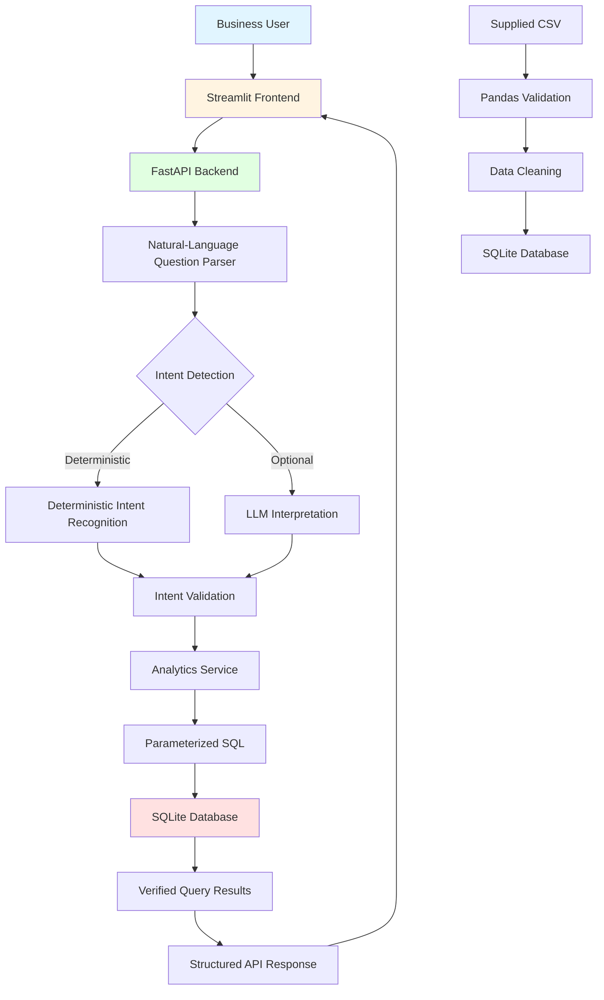

# Architecture Documentation

## System Architecture

## Component Responsibilities

### 1. Streamlit Frontend
- **Purpose**: User interface for natural language questions
- **Responsibilities**:
  - Display question input and example questions
  - Send HTTP requests to FastAPI backend
  - Display answers, tables, and charts
  - Show dataset metadata
  - Handle loading states and errors

### 2. FastAPI Backend
- **Purpose**: REST API server
- **Responsibilities**:
  - HTTP request validation with Pydantic
  - Route requests to appropriate handlers
  - Error handling and logging
  - Generate OpenAPI documentation
  - Coordinate between parser, analytics, and database

### 3. Natural-Language Question Parser
- **Purpose**: Understand user questions
- **Responsibilities**:
  - Deterministic pattern matching for common questions
  - Optional LLM-based interpretation for flexible language
  - Extract parameters (months, years, products, regions)
  - Identify analytical intent
  - Request clarification when needed

### 4. Deterministic Intent Recognition
- **Purpose**: Reliable pattern-based question understanding
- **Responsibilities**:
  - Match predefined regex patterns
  - Support 5 core question types
  - Extract structured parameters
  - Work without external API dependencies

### 5. LLM Interpretation (Optional)
- **Purpose**: Flexible natural language understanding
- **Responsibilities**:
  - Interpret ambiguous questions
  - Extract parameters from varied phrasing
  - Return structured JSON responses
  - Validate responses with Pydantic
  - Fallback to deterministic parser if unavailable

### 6. Intent Validation
- **Purpose**: Ensure intent and parameters are valid
- **Responsibilities**:
  - Validate month and year ranges
  - Check for required parameters
  - Reject unsupported intents
  - Return helpful error messages

### 7. Analytics Service
- **Purpose**: Execute business logic calculations
- **Responsibilities**:
  - Calculate total revenue
  - Find top product by revenue
  - Aggregate monthly revenue
  - Find top region by revenue
  - Compare revenue between months
  - Use parameterized SQL queries

### 8. Parameterized SQL
- **Purpose**: Safe database queries
- **Responsibilities**:
  - Prevent SQL injection
  - Use prepared statements
  - Query only allowed tables
  - Reject destructive operations
  - Enforce read-only access

### 9. SQLite Database
- **Purpose**: Persistent data storage
- **Responsibilities**:
  - Store sales transactions
  - Maintain indexes for performance
  - Support ACID transactions
  - Provide reliable query results

### 10. CSV Ingestion Process
- **Purpose**: Load external data into database
- **Responsibilities**:
  - Read CSV with Pandas
  - Validate column names and data types
  - Parse dates safely
  - Calculate revenue from quantity × price - discount
  - Handle missing and invalid records
  - Prevent duplicate transactions
  - Provide import summary

## Data Flow

### Question Processing Flow
1. User enters question in Streamlit UI
2. Frontend sends POST request to `/ask` endpoint
3. Backend validates request with Pydantic
4. Question parser determines intent (deterministic or LLM)
5. Intent and parameters are validated
6. Analytics service executes appropriate calculation
7. Parameterized SQL queries SQLite database
8. Results are formatted into structured response
9. API returns JSON to frontend
10. Frontend displays answer with supporting data

### CSV Import Flow
1. User places CSV file in `data/` directory
2. User runs data loader command
3. Pandas reads CSV file
4. Column mapping validates required fields
5. Each row is validated for completeness
6. Dates are parsed and converted
7. Revenue is calculated from quantity × price - discount
8. Valid records are inserted into SQLite
9. Invalid records are logged and skipped
10. Import summary is displayed

## Security Considerations

### SQL Injection Prevention
- All queries use parameterized statements
- SQL validator rejects destructive keywords
- Only SELECT queries are allowed
- Only authorized tables can be queried
- Multiple statements are rejected
- SQL comments are rejected

### API Security
- Request validation with Pydantic
- Error messages don't expose internal details
- No stack traces in responses
- Environment variables for sensitive data
- .env excluded from version control

### Data Validation
- CSV validation before database insertion
- Type checking for numeric fields
- Date format validation
- Rejection of negative quantities/prices
- Handling of missing values
- Prevention of duplicate transactions

## Scalability Considerations

### Current Design
- SQLite for simplicity and portability
- Single-machine deployment
- Synchronous request processing
- In-memory data processing with Pandas

### Future AWS Migration Options
- **Database**: Migrate to Amazon RDS (PostgreSQL or MySQL)
- **API**: Deploy FastAPI on AWS Lambda with API Gateway
- **File Storage**: Store CSV in Amazon S3
- **AI**: Use Amazon Bedrock for LLM integration
- **Authentication**: Add Amazon Cognito
- **Monitoring**: CloudWatch for logs and metrics

## Technology Rationale

### SQLite
- Lightweight, no server setup required
- Portable single-file database
- Sufficient for development and small datasets
- Easy to backup and migrate
- Built-in Python support

### FastAPI
- Modern, fast Python web framework
- Automatic OpenAPI documentation
- Pydantic integration for validation
- Async support for future scalability
- Type hints improve code quality

### Pandas
- Industry-standard for data processing
- Powerful CSV handling
- Built-in data validation
- Easy data transformation
- Familiar to data engineers

### Streamlit
- Rapid UI development in Python
- No frontend framework required
- Built-in charting components
- Easy to deploy and share
- Perfect for data applications

### Deterministic + LLM Hybrid
- Core functionality works without paid APIs
- LLM adds flexibility when available
- Fallback ensures reliability
- Modular design allows provider changes
- Cost-effective for development
